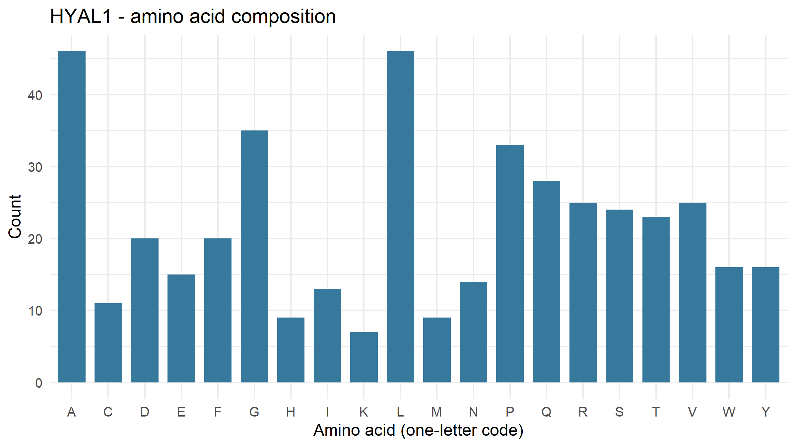
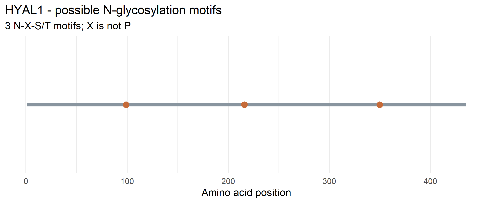

# Exploring Lysosomal Enzymes Using NCBI and R: HYAL1

**Name:** Shahanta Dawn B. Balanza  
**Section:** B  
**Course/Subject:** BS Biology – Cell and Molecular Biology  
**Selected Gene:** HYAL1  
**Enzyme Name:** Hyaluronidase-1  
**Organism:** *Homo sapiens* (Human)  
**NCBI RefSeq Protein Accession:** NP_695013.1

---


## 1. Enzyme and Gene Information

- **Gene symbol:** HYAL1
- **Enzyme name:** Hyaluronidase-1
- **Organism:** *Homo sapiens* (human)
- **NCBI Protein Accession:** NP_695013.1
- **NCBI Protein Record:** https://www.ncbi.nlm.nih.gov/protein/NP_695013.1

HYAL1 encodes hyaluronidase-1, a lysosomal enzyme that degrades hyaluronan, a component of the extracellular matrix. This breakdown contributes to the recycling of hyaluronan and its components.

## 2. Objective

The objective of this activity was to retrieve a human lysosomal enzyme protein sequence from NCBI, analyze its amino acid composition and potential N-linked glycosylation motifs using R, generate figures from the results, and publish the analysis in a GitHub repository.

## 3. Methods and Workflow

### Step 1. Retrieve the HYAL1 protein sequence from NCBI

The human HYAL1 protein sequence was selected from the NCBI Protein database using RefSeq accession NP_695013.1. The R script uses the `rentrez` package to retrieve the protein sequence in FASTA format.

**Code excerpt:**

```r
fasta <- rentrez::entrez_fetch(
  db = "protein",
  id = accession,
  rettype = "fasta",
  retmode = "text"
)
```

The retrieved sequence was saved as `data/HYAL1.fasta` for subsequent analysis.

**Result:** The retrieved HYAL1 protein sequence was analyzed as a sequence containing 435 amino acids.

**Source:** [NCBI Protein: HYAL1 NP_695013.1](https://www.ncbi.nlm.nih.gov/protein/NP_695013.1)

### Step 2. Analyze the amino acid composition

After retrieving the sequence, the R analysis counted the amino acid residues and calculated their percentages relative to the total sequence length. The results were saved in CSV files for further inspection.

**Code excerpt:**

```r
amino_acids <- strsplit(protein, "", fixed = TRUE)[[1]]
protein_length <- length(amino_acids)

standard_aa <- strsplit(
  "ACDEFGHIKLMNPQRSTVWY", "", fixed = TRUE
)[[1]]

counts <- table(factor(amino_acids, levels = standard_aa))

composition <- data.frame(
  amino_acid = standard_aa,
  count = as.integer(counts),
  percent = round(
    100 * as.integer(counts) / protein_length, 2
  )
)
```

**Results:**

The analyzed protein sequence contained 435 amino acids. The five most abundant amino acids were:

| Amino acid | Count | Percentage |
|---|---:|---:|
| Alanine (A) | 46 | 10.57% |
| Leucine (L) | 46 | 10.57% |
| Glycine (G) | 35 | 8.05% |
| Proline (P) | 33 | 7.59% |
| Glutamine (Q) | 28 | 6.44% |

The results were saved in `results/HYAL1_summary.csv` and `results/HYAL1_amino_acid_counts.csv`.

**Interpretation:** Alanine and leucine were tied as the most abundant amino acids, each accounting for 10.57% of the sequence. These findings describe the protein's amino acid composition but do not directly establish its enzyme activity.

### Step 3. Identify potential N-linked glycosylation motifs

The protein sequence was examined for the N-X-S/T pattern, where N represents asparagine, X can be any amino acid except proline, and S or T represents serine or threonine. This sequence pattern indicates a potential N-linked glycosylation site.

**Code excerpt:**

```r
i <- seq_len(protein_length - 2L)

positions <- i[
  amino_acids[i] == "N" &
  amino_acids[i + 1L] != "P" &
  amino_acids[i + 2L] %in% c("S", "T")
]

motifs <- if (length(positions) > 0) {
  substring(protein, positions, positions + 2L)
} else {
  character(0)
}

motif_table <- data.frame(
  position = positions,
  motif = motifs
)
```

**Results:**

Three potential N-linked glycosylation motifs were identified.

| Position | Motif |
|---:|---|
| 99 | NAS |
| 216 | NYT |
| 350 | NVT |

The motif positions were saved in `results/HYAL1_motif_positions.csv`. The summary file also records the number of detected motifs.

**Interpretation:** The three sequences match the potential N-linked glycosylation pattern. However, detecting a motif does not confirm that a carbohydrate group is attached to the protein. Experimental evidence would be needed to establish actual glycosylation.

### Step 4. Generate and inspect the figures

The R script uses the `ggplot2` package to generate visualizations of the amino acid composition and potential N-linked glycosylation motifs.

The resulting figures were saved in the `figures/` folder.

- `HYAL1_amino_acid_composition.png`
- `HYAL1_potential_N_glycosylation.png`

**Result:** Two figures were generated to visualize the amino acid composition and the locations of the three predicted motifs. These visualizations complement the numerical results saved in the CSV files.

## 4. Workflow Evidence

### RStudio Evidence: HYAL1 Analysis and Motif Identification

The screenshot below documents the execution of the HYAL1 analysis in RStudio. The Console displays the protein length of 435 amino acids, the five most common amino acids, and the completion message. The Environment panel also shows the `motif_table` containing three potential N-glycosylation motifs: NAS at position 99, NYT at position 216, and NVT at position 350.


The displayed output provides evidence that the R script completed the analysis and identified the three potential N-glycosylation motifs. The generated CSV files and figures are included in the repository for further inspection.


## 5. Results and Figures

### Figure 1. Amino Acid Composition of the HYAL1 Protein



The figure shows the distribution of amino acid residues in the HYAL1 protein sequence. Alanine and leucine were the most abundant residues, with 46 occurrences each.

### Figure 2. Potential N-Linked Glycosylation Motifs in HYAL1



The figure shows the locations of the three predicted motifs: NAS at position 99, NYT at position 216, and NVT at position 350. These are potential glycosylation sites, not experimentally confirmed modifications.

## 6. Guide Questions and Answers

### 1. What does your enzyme normally break down inside lysosomes?

HYAL1 encodes hyaluronidase-1, a lysosomal enzyme that degrades hyaluronan into smaller fragments. Hyaluronan is a component of the extracellular matrix, and its degradation contributes to the recycling of this material.

### 2. What is the total length of your protein, and which amino acids are most common?

The analyzed HYAL1 protein sequence contains 435 amino acids. Alanine (A) and leucine (L) are the most abundant, with 46 residues each (10.57%). They are followed by glycine (G), with 35 residues (8.05%); proline (P), with 33 residues (7.59%); and glutamine (Q), with 28 residues (6.44%).

### 3. How many potential N-glycosylation motifs did you find? Where are they located?

Three potential N-linked glycosylation motifs were identified: NAS at position 99, NYT at position 216, and NVT at position 350. These sequences follow the N-X-S/T pattern, in which X can be any amino acid except proline. Their presence does not confirm actual glycosylation.

### 4. Why can glycosylation matter for lysosomal proteins? Does finding a motif prove the protein is glycosylated?

Glycosylation can help proteins fold correctly, maintain stability, and support their transport and function. Certain carbohydrate modifications, such as mannose-6-phosphate, can help direct lysosomal enzymes to lysosomes. However, identifying an N-X-S/T motif does not prove that a carbohydrate group is attached. Sequence analysis alone also cannot confirm the presence of a mannose-6-phosphate tag.

### 5. What could happen in the cell if your enzyme did not work properly?

If HYAL1 does not function properly, hyaluronan degradation can be impaired, leading to the accumulation of hyaluronan or its fragments. HYAL1 deficiency is associated with mucopolysaccharidosis type IX, a rare lysosomal storage disorder. Impaired enzyme function can therefore disrupt normal cellular and tissue processes.

## 7. Repository Contents

- `lysosomal_enzyme_analysis.R` — R script used for the analysis
- `data/HYAL1.fasta` — retrieved HYAL1 protein sequence
- `results/HYAL1_summary.csv` — protein length and potential motif count
- `results/HYAL1_amino_acid_counts.csv` — amino acid counts and percentages
- `results/HYAL1_motif_positions.csv` — predicted motif positions and sequences
- `figures/HYAL1_amino_acid_composition.png` — amino acid composition figure
- `figures/HYAL1_potential_N_glycosylation.png` — potential glycosylation motif figure

## 8. Conclusion

The analysis of the human HYAL1 protein identified a sequence length of 435 amino acids and three potential N-linked glycosylation motifs. Alanine and leucine were the most abundant amino acids. The workflow demonstrates how NCBI and R can be used to retrieve a protein sequence, characterize its amino acid composition, identify potential sequence motifs, and generate visualizations. These findings describe sequence features but do not directly measure glycosylation or enzyme activity.

## 9. Reference

National Center for Biotechnology Information. (n.d.). *HYAL1 [Homo sapiens] protein sequence, RefSeq accession NP_695013.1*. https://www.ncbi.nlm.nih.gov/protein/NP_695013.1
